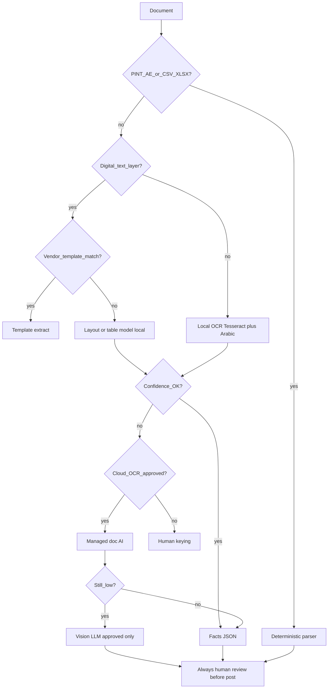

# 03 — Ingestion, extraction, classification

**Retrieval date for citations: 2026-10-03.**  
**Data policy:** synthetic only until owner confirms; **no files leave the machine** for cloud OCR/LLM until separately approved.

## 1. Summary

Intake must support upload, Drive/ERP folder sync, and later messaging channels into one pipeline: malware-safe, idempotent by content hash, classified, extracted via a cost ladder, and never auto-filed. E-invoicing (PINT AE) is **intake of structured invoices from an ASP**, not issuance by arnibooks in v1. Client playbooks drive classification and rules. Low-confidence items use an ask-the-client loop. Hard invariants are enforced in code.

## 2. Options table

| Topic | Options | Trade-offs | Cost | Reversibility | Flip evidence |
|---|---|---|---|---|---|
| Upload | Direct multipart · Pre-signed S3/MinIO · Resumable (TUS) | Multipart simple; pre-signed scales; resumable for large PDFs | Eng M for resumable | High | >50MB average packs fail without resumable |
| Extraction | Structured/XML first · Templates · Layout OCR · Managed OCR · Vision LLM last | Accuracy↑ cost↑; LLM last reduces spend | See doc 04 | High (router) | Benchmark field F1 |
| Channels | Upload-only · +Drive/ERP · +Email · +WhatsApp/Telegram | Channel sprawl vs ops reality | See §6 | Medium | Ops volume from Drive |
| E-invoice | Issue in arnibooks · Intake-only via ASP · Defer | Issuing = ASP product; intake unlocks 2027 | Intake M | High | Client ASP contracts |

## 3. Recommendation (confidence: **high**)

**Default path:** pre-signed uploads + hash idempotency + classification cascade + extraction ladder (structured → text PDF templates → local OCR → managed OCR only when approved → vision LLM last). Ship **Drive/ERP read-only sync** in Stage A/B parallel track after portal security PASS. **Do not issue e-invoices in v1**; design PINT AE XML intake. Messaging channels after Drive.

### 3.1 Intake controls

| Control | Spec |
|---|---|
| Upload | Pre-signed PUT to object store; max size **UNVERIFIED** default 50MB/file, 200 pages/PDF pending ops |
| Resumable | Required for ≥20MB (TUS or S3 multipart) |
| Zip/batch | Server-side unpack; each member own sha256 + malware scan |
| Malware | ClamAV or AWS/vendor scan **before** extract; quarantine on hit |
| Preview | First-page raster + text layer if present; no external send |
| Idempotency | `sha256(content)` unique per client; duplicate → link existing |
| Retries / DLQ | Job attempts with backoff; DLQ + human replay |
| Dead letter | Preserve original object; never silent drop |

Storage layout: `s3://{bucket}/{client_id}/{yyyy}/{mm}/{sha256}.{ext}` (+ `pages/{n}.png` derivatives).

### 3.2 Extraction ladder (decision tree)

| Method | Accuracy | Cost | Latency | Languages | Notes |
|---|---|---|---|---|---|
| PINT AE / structured | Highest | ~0 | Low | N/A | Preferred 2027+ |
| Text-layer + template | High if template | Low | Low | EN/AR if Unicode | Vendor memory |
| Local OCR (Tesseract) | Medium; Arabic **UNVERIFIED** until bench | Infra only | Med | eng+ara packs | Current worker |
| Managed OCR (e.g. Textract) | High tables/forms | See [aws.amazon.com/textract/pricing](https://aws.amazon.com/textract/pricing/) — DetectDocumentText ~$0.0015/page first 1M (US West Oregon list price; region TBD) | Med | Check Arabic support per API | **Off-machine — requires approval** |
| Vision LLM | Variable | Token $ **UNVERIFIED** | High | Strong multilingual | Last resort; never auto-post |

Hard cases: rotation/skew preprocess; multi-page split; multi-doc PDF classifier; photos; handwriting → human; PII (Emirates ID, passport, trade licence) → detect, redact preview, short retention, never LLM without approval.

### 3.3 Classification

Taxonomy (v1): `BANK_STATEMENT`, `SALES_INVOICE`, `PURCHASE_INVOICE`, `CREDIT_NOTE`, `TALLY_OR_LEDGER_EXPORT`, `E_INVOICE_XML`, `PII_KYC`, `OTHER`, `UNKNOWN`.

Cascade: MIME/filename → folder path signal (Drive) → structure heuristics → keyword/rules → small classifier → LLM fallback (approved) → **UNKNOWN** (human triage). Calibrated confidence; below threshold never auto-posts. Dedupe by sha256 + soft match (TRN+invoice#+amount+date).

### 3.4 Google Drive + ERP folder import

| Rule | Spec |
|---|---|
| Auth | Read-only service account; least privilege; secrets in KMS/SM |
| Mapping | Folder → `client_id`; subfolder/name patterns → doc type hint |
| Sync | Incremental by Drive revision / ERP watermark; never delete local on remote delete without policy |
| Dedupe | Content sha256 |
| Classification | Folder name is **signal**, always checked against content; mismatch → warning + human |
| Gate | **No real Drive sync until portal security review PASS** (doc 01/06) |
| ERP | Name/API **unknown** — design adapter interface; implement when named |

### 3.5 Capture channels (priority)

| Channel | Priority | Cost / limits | Residency / privacy | Notes |
|---|---|---|---|---|
| Upload UI | P0 | Low | In-region store | Default |
| Google Drive | P0/P1 | Google API quotas **UNVERIFIED** | Data passes Google; DPA needed | Current Arnifi ops |
| ERP folder | P1 | Depends on ERP | Vendor cloud | Adapter TBD |
| Email-in | P2 | Mailbox + parse | PII in mail | Per-client address |
| WhatsApp Business API | P3 | Meta rates **UNVERIFIED** | Off-UAE likely; high privacy risk | Consent + retention |
| Telegram | P3 | Bot API | Same risks | Lower priority than WhatsApp |

### 3.6 E-invoicing (PINT AE) — MoF primary sources

| Fact | Source |
|---|---|
| Programme hub | [MoF eInvoicing](https://mof.gov.ae/en/about-us/initiatives/einvoicing/) |
| Implementation timelines | Ministerial Decision **244 of 2025** (amended by Resolution **66 of 2026** — ASP appointment for ≥AED 50m moved to **30 Oct 2026**; go-live **1 Jan 2027** unchanged) — MoF news [amendments](https://mof.gov.ae/en/news/ministry-of-finance-announces-targeted-amendments-to-einvoicing-system-decisions/) |
| Scope / obligations | Decision **243 of 2025** (linked from MoF hub) |
| ASP accreditation; **PINT AE** defined | Decision **64 of 2025** — [MoF PDF](https://mof.gov.ae/wp-content/uploads/2025/03/Ministerial_Decision_Eligibility_and_Accreditation_procedure_for_SPs_EN.pdf) |
| Smaller businesses | ASP by **31 Mar 2027**, live **1 Jul 2027**; government live **1 Oct 2027** — MoF news on 243/244 ([timelines announcement](https://mof.gov.ae/en/news/ministry-of-finance-announces-the-issuance-of-two-ministerial-decisions-on-the-scope-of-obligations-and-the-timelines-for-implementing-the-electronic-invoicing-system-2/)) |

**v1 assumption:** arnibooks **does not issue** invoices. It **ingests** PINT AE XML (and PDFs) from client/ASP exports into the same extraction→postings path.

### 3.7 Client playbook + ask-the-client + MCP

**Playbook (versioned JSON per client):** VAT registered?, TRN, period frequency, free zone flags, COA map, supplier rules, approval thresholds, FX policy, folder mappings. Every classification/rule run stamps `playbook_version`.

**Ask-the-client:** low-confidence field → portal/email question → answer stored as `correction` with provenance → feeds memory (doc 05) after approval.

**MCP/API agent (optional, later):** read-only tools first; scoped tokens; full audit of tool calls; no post/release/delete tools until SoD review. Data-governance risk: treat as privileged user.

### 3.8 Invariants (enforced)

1. No filing / sending / deleting without approval.  
2. VAT recoverable claim requires valid TRN.  
3. Every journal line links to source document/extraction version (or explicit opening/cut-over type).

## 4. Cost and effort

| Work | Likely pw |
|---|---|
| Pre-signed + hash + DLQ | 3 |
| Classification cascade | 3 |
| Drive connector | 4 |
| ERP adapter stub | 2 |
| PINT AE parser | 3 |
| Ask-client loop | 3 |

## 5. Risks and mitigations

| Risk | Mitigation |
|---|---|
| Cloud OCR on real PDFs | Kill switch; synthetic until approval |
| Folder mis-map to wrong client | Dual signal + quarantine |
| WhatsApp PII sprawl | Defer; consent; short retention |
| ASP lock-in for e-invoice | Intake standards (PINT AE), not issuer |

## 6. Evidence still needed

- Max file size/page limits from ops.
- ERP name + API.
- Google Workspace DPA / shared-drive layout.
- Arabic OCR accuracy from doc 04 benches.
- Whether any client already has an ASP (for PINT samples).

## 7. Open questions (≤10)

1. Approve cloud OCR/LLM ever, or local-only indefinitely?
2. Drive shared-drive root structure standard?
3. ERP name/API?
4. Per-client email-in in year 1?
5. PII docs retained how many days?
6. Who owns playbook edits (ops vs client)?
7. MCP in year 1 or later?
8. Sample anonymised PINT AE XML available?
9. Zip password-protected statements — supported?
10. Multi-client zip uploads allowed?
